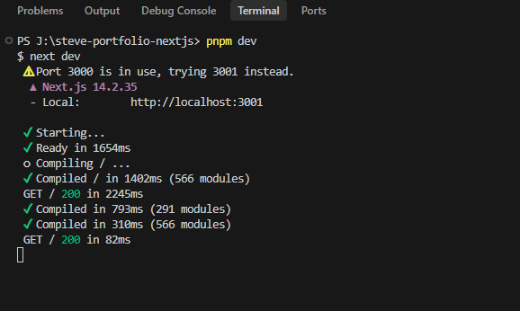
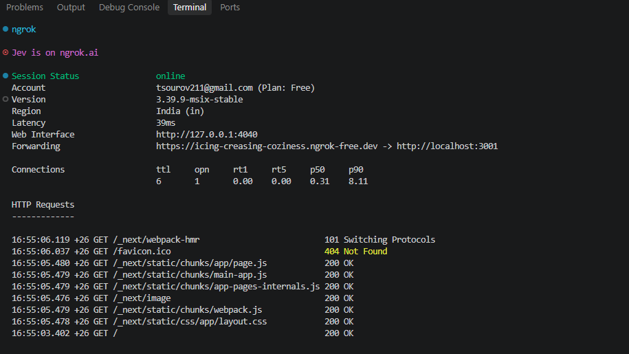

# DevOps Engineering - Module 1 Assignment

**Student:** Tanvr Ahammed Sourov  
**Course / Batch:** 15  
**Submission date:** 10 October 2026

This repository contains the answers to all theoretical and scenario-based questions, plus the recorded results for both practical tasks. The demo application was a **Next.js portfolio website**. [View the portfolio application's source code repository](https://github.com/tsourov211-eng/steve-portfolio-nextjs).

## Table of Contents

- [Part A — Theoretical Questions](#part-a--theoretical-questions)
- [Part B — Scenario-Based Questions](#part-b--scenario-based-questions)
- [Part C — Technical and Practical Tasks](#part-c--technical-and-practical-tasks)
- [Repository Structure](#repository-structure)

---

## Part A - Theoretical Questions

### A1. What is DevOps Engineering, and how does it differ from traditional development and operations?

DevOps Engineering combines software development (Dev) and IT operations (Ops) through shared responsibility, collaboration, automation, continuous integration and delivery (CI/CD), infrastructure as code, and monitoring. The goal is to deliver changes more frequently and safely while keeping systems reliable.

In a traditional siloed model, developers may focus on writing features and hand work to a separate operations team for deployment and support. This can create delays and blame when something fails. In DevOps, teams share ownership from code through production, automate repeatable work, monitor outcomes, and use feedback to improve the next release. DevOps is a culture and set of practices, not just a single tool or job title.

### A2. How does DevOps fit into the SDLC? Name at least three phases.

DevOps supports the full Software Development Life Cycle (SDLC):

- **Planning:** Teams plan small, measurable changes, define acceptance criteria, and agree on reliability goals.
- **Development and version control:** Git workflows, code review, and branch protections help teams collaborate and track changes.
- **Build and testing:** CI pipelines automatically build the application and run tests, catching defects early.
- **Release and deployment:** CD pipelines deploy repeatably, using staging, approval checks, canary releases, or automated rollback where appropriate.
- **Operations and monitoring:** Metrics, logs, traces, alerts, and health checks reveal performance issues and failures.
- **Maintenance and feedback:** Incident reviews and user feedback guide fixes and future improvements.

### A3. What values does a DevOps Engineer bring? Explain four with examples.

1. **Faster, repeatable delivery:** A CI/CD pipeline automatically tests and packages code, so a team can release a small feature without a long manual checklist.
2. **Reliability and service quality:** Health checks, alerts, and rollback procedures help detect a failing release and restore service quickly.
3. **Automation and consistency:** Infrastructure as code and deployment scripts reduce manual configuration errors between development, test, and production environments.
4. **Collaboration and shared ownership:** Developers and operations staff review incidents together, share runbooks, and fix the underlying cause rather than blaming another team.

### A4. Why is prior Software Engineering (SWE) experience helpful?

Software Engineering experience helps a DevOps Engineer understand how applications are built, tested, packaged, configured, and debugged. Familiarity with source control, APIs, dependencies, logs, testing, and code reviews makes it easier to build useful pipelines and work with developers. SWE experience is helpful, but it is not an absolute requirement; a learner can build these skills through projects and practice.

### A5. Why is networking knowledge important for DevOps?

Applications and infrastructure communicate over networks. IP addressing identifies network interfaces; DNS maps names to IP addresses; ports identify services on a host; and protocols such as HTTP/HTTPS, TCP, and UDP define how data is exchanged. This knowledge helps diagnose errors such as a wrong DNS record, blocked port, TLS failure, connection timeout, or service listening on the wrong interface. It is also important for configuring load balancers, firewalls, cloud networks, and service-to-service communication.

### A6. What soft skills are essential, and how do they help during incidents?

- **Clear communication:** Share the impact, current status, owner, and next update so teammates and stakeholders know what is happening.
- **Teamwork and empathy:** Bring developers, operations, security, and support together without blame.
- **Problem-solving and critical thinking:** Use logs, metrics, and evidence to test hypotheses instead of guessing.
- **Calmness and patience:** Avoid rushed changes that could worsen an outage.
- **Documentation:** Record commands, decisions, timelines, and fixes so the team can respond faster next time.

During an incident, these skills help the team coordinate work, protect customer trust, and resolve the problem methodically.

### A7. Why are patience and a troubleshooting mindset important? Give a real-life example.

Production symptoms often have several possible causes, so changing many things at once makes the root cause harder to find. A patient engineer checks evidence, changes one variable at a time, and verifies the result.

**Example:** After a release, users receive HTTP 502 errors. The engineer checks the service dashboard and logs, confirms the web proxy is healthy but the application upstream is unreachable, and compares the new deployment configuration with the last working version. The engineer discovers that the app’s configured port changed but the proxy still points to the old port. They restore the correct configuration (or roll back), verify the health endpoint, monitor error rates, and document the root cause. This controlled approach is safer than randomly restarting services.

---

## Part B — Scenario-Based Questions

### B1. How would you onboard a new student unfamiliar with GitHub and cloud platforms?

1. Share a welcome message, course roadmap, expected setup, communication channel, and a single onboarding checklist.
2. Help the student create or access a GitHub account, install Git, configure their name/email, and practise clone, status, add, commit, push, and pull requests using a safe practice repository.
3. Provide a beginner-friendly README, short videos or official documentation links, and a small first task such as editing a README and opening a pull request.
4. Introduce cloud concepts through a sandbox or free-tier environment with least-privilege permissions. Explain budgets and avoid sharing root credentials, access keys, or tokens.
5. Set up a dedicated Discord, Slack, or Teams channel for questions; assign a mentor or buddy; hold short check-ins; and ask the student to explain or demonstrate each milestone.

### B2. An application goes down during a production deployment. What steps would you take?

1. **Acknowledge and assess:** Confirm the alert, identify user impact and severity, and declare an incident when appropriate.
2. **Coordinate:** Open the incident channel, assign an incident lead and technical responders, and share brief status updates.
3. **Stabilize:** Stop further rollout. If the new release is likely responsible and rollback is safe, restore the last known-good version or shift traffic away from the unhealthy instances.
4. **Diagnose using evidence:** Compare the deployment timeline with metrics, logs, traces, health checks, configuration changes, dependency health, and infrastructure events. Check DNS, networking, secrets/configuration, database migrations, and resource limits where relevant.
5. **Apply and verify a fix:** Test the fix, confirm health checks and key user flows, and monitor error rate, latency, and saturation.
6. **Communicate and learn:** Announce recovery and remaining risks. Afterward, conduct a blameless post-incident review and create action items such as new tests, safer rollout checks, better alerts, or a clearer runbook.

### B3. Releases are frequent, but stability is decreasing. How can DevOps balance speed and reliability?

Use automated unit, integration, and smoke tests in CI; require code review and quality gates; deploy to staging; release in small batches; and use canary or blue-green deployment and feature flags when suitable. Define service-level indicators/objectives (SLIs/SLOs), monitor error rates and latency after release, and make rollback fast and tested. Review incidents and failed deployments to improve the pipeline. Speed should come from repeatable automation and smaller changes, not from skipping safety checks.

### B4. How can onboarding to communication platforms improve workflows for a distributed team?

Set up agreed channels for normal work, alerts, and incidents; document channel purpose and escalation rules; integrate monitoring alerts and deployment notifications; and provide an incident template with severity, impact, owner, actions, and the next update time. Make sure everyone can access runbooks and knows how to join an incident call. Use written handoffs across time zones and record decisions in a shared place. Consistent onboarding reduces delays, duplicate work, and missed context.

---

## Part C — Technical and Practical Tasks

### Task 1 — Local DevOps Demo Application

**Application:** Next.js Portfolio Website  
**Source code repository:** [tsourov211-eng/steve-portfolio-nextjs](https://github.com/tsourov211-eng/steve-portfolio-nextjs)  
**Local address:** `http://localhost:3001`  
**Start command:** `pnpm dev`

The application used for this practical task is maintained in the linked portfolio repository above. This assignment repository contains the written answers and screenshot evidence.

**Steps performed**

1. Opened the project in VS Code.
2. Ran `pnpm dev` in the terminal.
3. The application started successfully at `http://localhost:3001`.
4. Opened the URL in a browser and verified that the website loaded correctly.
5. The terminal displayed `GET / 200`, confirming a successful HTTP response.

**How local development helps in DevOps:** Running applications locally allows developers to test code, identify bugs, and fix errors before deployment. It also supports automated testing, continuous integration, and safer software delivery. Local testing helps verify the app and its configuration, reproduce bugs safely, test health checks, and catch problems early without affecting production. The same local checks can later become automated CI tests.

### Task 2 — Exposing the Local Application with ngrok

**Tool:** ngrok  
**Command used:** `ngrok http 3001`  
**Public URL recorded in the assignment:** [https://icing-creasing-coziness.ngrok-free.dev](https://icing-creasing-coziness.ngrok-free.dev)

**Steps performed**

1. Started the Next.js application locally on port 3001.
2. Used `ngrok http 3001` to expose the application to the internet.
3. Verified that ngrok showed an online session and generated a public URL.

**Real-world use case:** Developers can share locally running applications with clients or teammates for remote testing and feedback before production deployment.

> **URL note:** This is the URL recorded when the evidence was captured. Free ngrok URLs or sessions may change or stop working when the tunnel is closed; start ngrok again to obtain a current URL if required.

### Task 1 Evidence — Local Application

**Browser: Next.js portfolio running at localhost:3001**


**Terminal: development server output and successful HTTP response**



### Task 2 Evidence — ngrok Public Tunnel

**Browser: portfolio opened through the ngrok public URL**


**Terminal: ngrok session, forwarding address, and HTTP requests**



---

## Repository Structure

```text
DevOps-Module-1-Assignment-01/
├── README.md
└── screenshots/
    ├── localhost001.png
    ├── localhost002.png
    ├── ngrok001.png
    ├── ngrok002.png
    └── practical-evidence.svg
```

All theoretical answers, scenario responses, and practical-task screenshot evidence are included in this repository.
